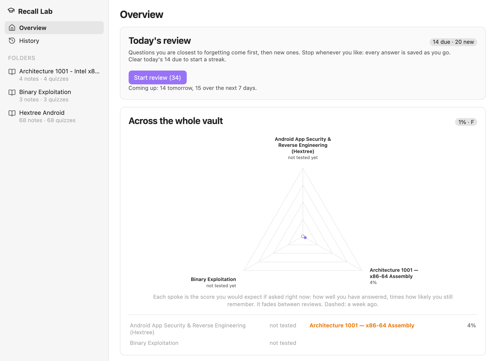
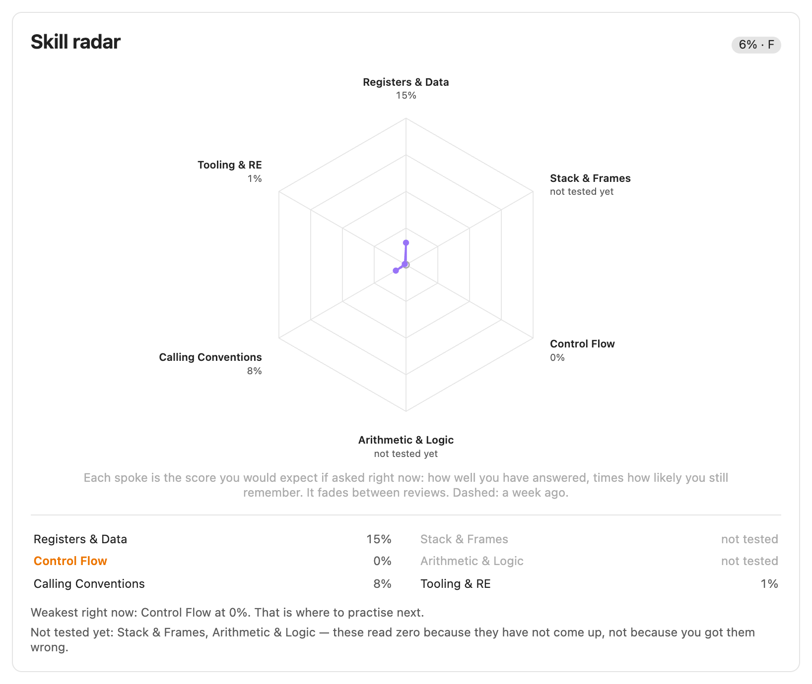
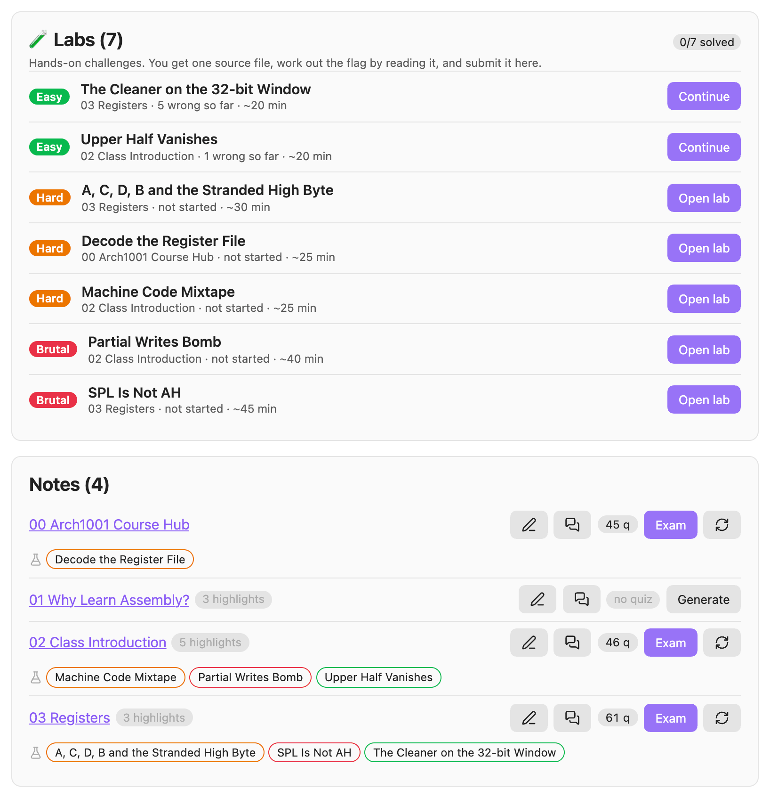
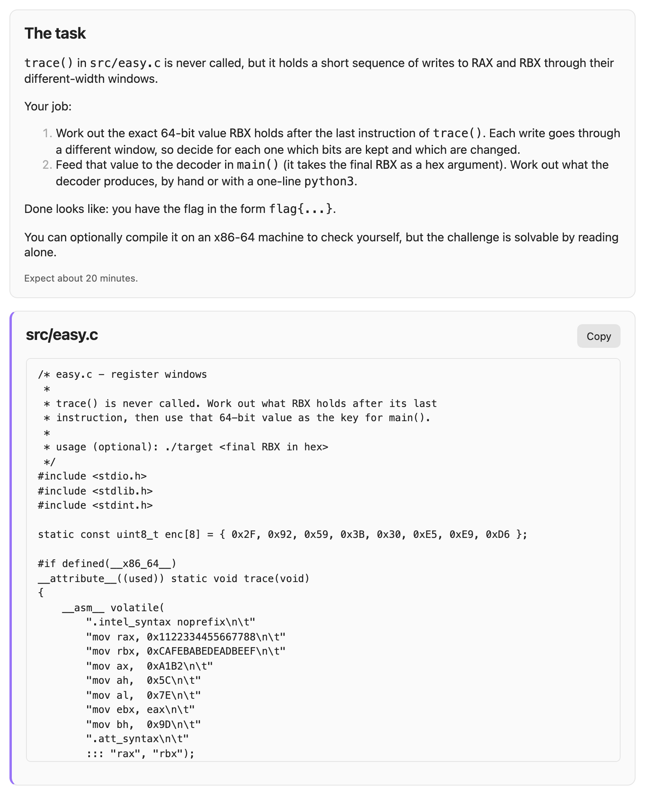
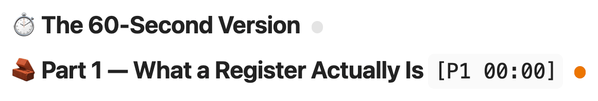
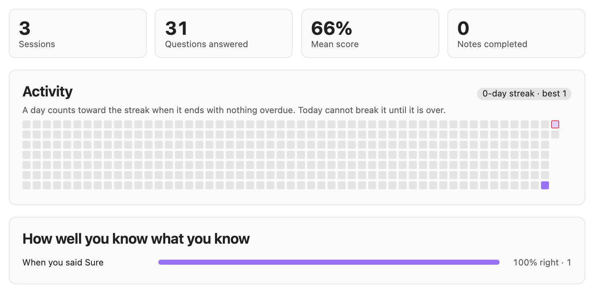
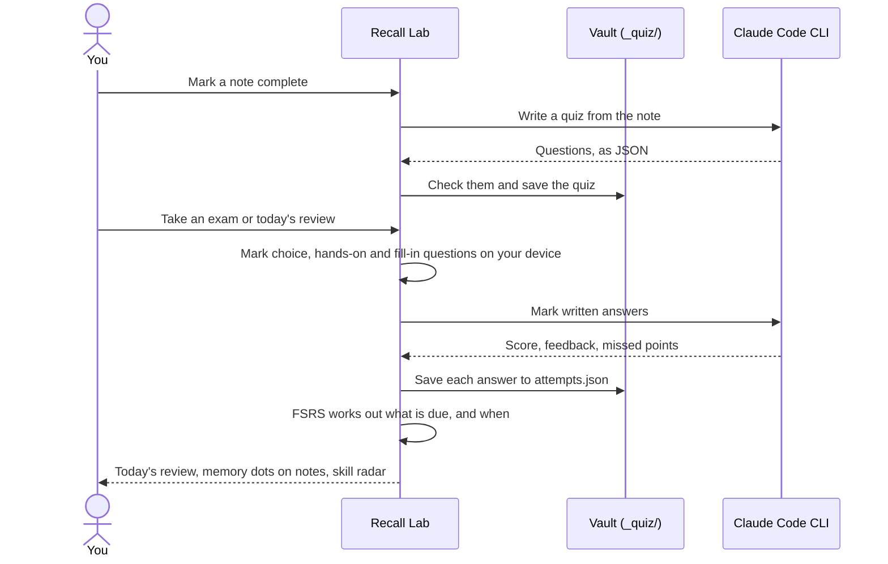

<h1 align="center">Recall Lab</h1>

<b>Turn your Obsidian notes into long-term memory.</b>

Spaced-repetition reviews, tiered exams, CTF-style labs and a skill radar over your own notes. 
Claude writes them and marks open answers through the Claude Code CLI, so you don't need an API key.

  
  
  
  

  <a href="#install">Install</a> ·
  <a href="#quick-start">Quick start</a> ·
  <a href="docs/user-guide.md">User guide</a> ·
  <a href="docs/bank-format.md">Question format</a> ·
  <a href="docs/development.md">Development</a> ·
  <a href="CHANGELOG.md">Changelog</a>

  

## Features

- **A daily review** scheduled by [FSRS](https://github.com/open-spaced-repetition/ts-fsrs). The questions you are closest to forgetting come first, then new ones up to a daily limit.
- **Exams in three tiers**: easy (recall), hard (application) and brutal (synthesis and hands-on). Claude writes them from each note. Hard unlocks once you own 80% of a note's Easy questions, and Brutal once you own 80% of its Hard ones.
- **More than multiple choice**: written and shell-command answers, click the bug, register traces, ordering and matching. Your own `==highlights==` also become fill-in-the-blank questions, which join your daily review as soon as you write them.
- **CTF-style labs**, in three shapes: a source file you solve by reading, a **compiled x86-64 binary you reverse**, or a **vulnerable program you exploit** to reach a `win` path. You use your own tools — Ghidra, gdb, pwntools, whatever you like. Challenges are built from your notes, so they test what your course actually covers.
- **Memory on your notes**: a dot on each heading that has questions, plus a due count in each note's footer and in the status bar.
- **A skill radar** for each course and for the whole vault. Each spoke is the score you could expect on that skill area today.
- **Help when you are stuck**: a nudge and a second try, guided steps, a leech clinic, *Write it all down* and *Teach it back*.

## A quick tour

### Reviews and exams

Every question has three submit buttons. Picking *Guessing* or *Sure* changes when the question comes back. You can also answer from the keyboard with `1`–`9`, `Enter`, `G` and `S`.

### Skill radar

Claude names 5–7 skill areas for each course. Each spoke shows the score you could expect on that area today. It counts questions you haven't answered yet as zero, and it fades between reviews.

### Courses

Each note in a course can have a quiz and three labs, plus two exercises led by Claude: *Write it all down* (the pencil) and *Teach it back* (the speech bubble).

### Labs

A lab gives you one source file with a flag hidden in it, and you can solve it just by reading. The flag is checked on your device, and only its SHA-256 hash is stored.

Hints are nudges of a few words, the way a CTF writes them. Each hint costs 15% of the lab's score.

### Memory on your notes

In reading view, each heading that has questions gets a dot. Green means an expected score of 80% or more, amber 50% or more, red below that, and grey means no answers yet.

Each note's footer shows what is due in the note and has a button to review it. **Complete** marks the note as read and builds its quiz. The status bar shows how many questions are due today.

### History

History shows your sessions and scores, and a year of activity with your streak. It also shows how often you were right when you said *Sure*.

## How it works

- **Marked on your device.** Choice, hands-on and fill-in-the-blank questions are marked instantly, offline.
- **Marked by Claude.** Written, command and image answers go to the Claude Code CLI with the question's rubric and the strictness you chose. If an answer matches the question's accept pattern, it passes without a request. If Claude can't be reached, the answer is kept, but it never counts against you.
- **Scheduled from your history.** Every answer is saved to `_quiz/progress/attempts.json`. The schedule is rebuilt from that file each time, so it always matches your real history.

## Requirements

- **Obsidian 1.7.2 or later**, on desktop.
- **The Claude Code CLI**, installed and signed in. Recall Lab finds it in the usual install locations. If it doesn't, set **Settings → Recall Lab → Path to the Claude binary**, then press **Test** under **Check the connection**.
- **macOS or Linux.** Recall Lab is developed and tested on macOS. Windows is untested. It also needs `claude.exe` from Claude Code's native installer; an npm install only provides `claude.cmd`, which Recall Lab can't start.

## Install

**From Obsidian:**

1. Open **Settings → Community plugins** and turn off Restricted mode if it is on.
2. Select **Browse** and search for **Recall Lab**.
3. Select **Install**, then **Enable**.

Updates then arrive through Obsidian. The plugin's page in the directory is [community.obsidian.md/plugins/recall-lab](https://community.obsidian.md/plugins/recall-lab).

**By hand:**

1. From the [latest release](https://github.com/MYounas126/recall-lab/releases/latest), download `main.js`, `manifest.json` and `styles.css`.
2. Put the three files directly in `<vault>/.obsidian/plugins/recall-lab/`.
3. Reload Obsidian, then enable **Recall Lab** under **Settings → Community plugins**.

Each file has a GitHub build attestation. `gh attestation verify main.js -R MYounas126/recall-lab` checks it was built from this repository. To update by hand, replace the three files and reload Obsidian.

Your quizzes, labs and history live in the vault, so they are kept across updates.

## Quick start

1. Open Recall Lab with the graduation-cap icon in the ribbon, or run **Recall Lab: Open view**.
2. Pick a folder of notes under **Folders** and press **Set up this course**. Claude reads a sample of the notes and names the course's skill areas.
3. To build a quiz, press **Generate** next to a note. Or press **Complete** at the end of a note you have finished reading.
4. Press **Exam** to take the quiz. After that, the questions you need appear in **Today's review** on the overview.

## Documentation

- **[User guide](docs/user-guide.md)**: every feature, plus settings, commands, keyboard shortcuts and the files Recall Lab keeps.
- **[Question bank format](docs/bank-format.md)**: the JSON format quizzes are stored in, for editing quizzes or writing your own.
- **[Development](docs/development.md)**: building, testing, CI and how releases are made.
- **[Changelog](CHANGELOG.md)**: what each release added and fixed.
- **[Contributing](CONTRIBUTING.md)**: how to report a bug or send a change.

## Privacy and disclosures

- **A Claude account and plan.** Writing quizzes, labs and a course's skill areas, and marking written answers, needs Claude. Recall Lab uses the Claude Code CLI on your own subscription. It has no API key of its own and charges nothing.

  Once a quiz exists, the following work without Claude:
  - its choice, hands-on and fill-in-the-blank questions;
  - your reviews of them;
  - the radar and History.
- **Network use.** Recall Lab makes no network requests of its own. The Claude Code CLI it starts sends the note or answer involved to Anthropic.
- **Programs it runs.** Recall Lab is desktop only. It starts the `claude` command-line tool. To find it, it checks the usual install locations, then asks your login shell (`command -v claude`).
- **Files outside the vault.** Everything Recall Lab keeps is in your vault, under `_quiz/`. The one exception is a lab you choose to write to disk, so you can compile or run it yourself: its files go to `~/RecallLab/labs/`. Recall Lab never runs them on your machine.
- **Docker, for binary challenges only.** A binary challenge is compiled, and run once on its intended input to prove it can be solved, inside a throwaway x86-64 Linux container with no network, a read-only system and no privileges. Nothing is built or run on your machine. If you never ask for a binary challenge, Docker is never used.
- **Nothing else.** There is no telemetry, no ads and no Recall Lab account. Lab flags are stored only as SHA-256 hashes.

## License

[MIT](LICENSE) © 2026 Muhammad Younas – [r00tlv.me](https://r00tlv.me)
