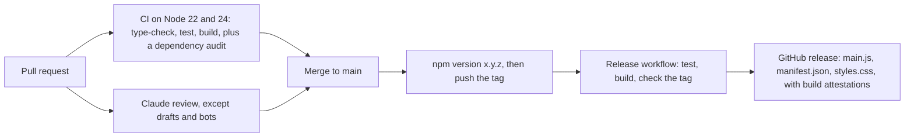

# Development

## Set up

You need Node.js 22 or later.

```bash
git clone https://github.com/MYounas126/recall-lab.git
cd recall-lab
npm install
```

| Command | What it does |
|---|---|
| `npm run dev` | Rebuilds `main.js` on every change. |
| `npm run build` | Type-checks, then makes a minified production `main.js`. |
| `npm test` | Runs every test under Node, including the view tests, with a stand-in for Obsidian. |
| `npm run check` | Checks that `manifest.json`, `package.json` and `versions.json` agree. |

To try a build in Obsidian:

1. Copy `main.js`, `manifest.json` and `styles.css` into `<vault>/.obsidian/plugins/recall-lab/`.
2. Reload Obsidian.

## Project layout

| Path | What it holds |
|---|---|
| `src/main.ts` | The entry point: commands, the ribbon icon, the status bar, and the note footers and memory dots. |
| `src/view.ts` | The Recall Lab pane: overview, courses, exams, labs and history. |
| `src/tasks.ts` | Every prompt sent to Claude, and the checks on what comes back. |
| `src/claude.ts` | Finds and runs the Claude Code CLI. |
| `src/store.ts` | Reads banks and courses, and saves attempts, sessions and lab progress. |
| `src/memory.ts` | The FSRS review schedule, rebuilt from the answer history. |
| `src/radar.ts`, `src/notemap.ts` | The skill radar, and the memory dots on headings. |
| `src/gates.ts` | The tier gates: which tiers of a quiz are open. |
| `src/crackme.ts` | Reversing challenges: the prompt, and the checks that one can be solved. |
| `src/pwn.ts` | Exploitation challenges: the prompt, the per-tier protections, and the checks that the bug is real. |
| `src/sandbox.ts` | The container challenges are built and checked in. |
| `src/labs.ts`, `highlights.ts`, `blurt.ts`, `teach.ts`, `leeches.ts`, `variants.ts`, `guided.ts`, `recall.ts` | One feature each. |
| `test/` | Tests (see [Testing](#testing)). |
| `scripts/` | Release helpers (`check-release.mjs`, `release-notes.mjs`, `version-bump.mjs`) and the vault smoke test (`smoke-test.js`). |

## Testing

`npm test` runs two kinds of test with Node's built-in test runner:

- **Logic tests** cover the schedule, tier gates, marking, quiz checks and the vault files. They run against an in-memory vault.
- **View tests** (`test/view.test.ts`) draw the real Recall Lab view in [jsdom](https://github.com/jsdom/jsdom), over the same in-memory vault. Every screen must draw without an error. The tests then check what the screens say, for example that an exam leaves locked tiers out and that the results page names a tier that has just opened. `test/dom.ts` gives jsdom the helpers Obsidian adds to every element, such as `createDiv` and `setText`.

`test/run.mjs` bundles each test with esbuild, using `test/obsidian-shim.ts` in place of the `obsidian` module.

**Before a release**, try the build in a real vault:

1. Copy `main.js`, `manifest.json` and `styles.css` into the vault's plugin folder, then reload Obsidian.
2. In the developer console, run the smoke test:

   ```js
   await require("/path/to/recall-lab/scripts/smoke-test.js")(app)
   ```

It opens the overview, History, every course, an exam, a lab and today's review, and reports any screen that fails to draw. It answers nothing and never calls Claude.

## CI/CD



| Workflow | Runs on | What it does |
|---|---|---|
| [`ci.yml`](../.github/workflows/ci.yml) | Every push to `main` and every pull request | See below. |
| [`release.yml`](../.github/workflows/release.yml) | Pushing a version tag | Builds and publishes a release. See [Releasing](#releasing). |
| [`claude-code-review.yml`](../.github/workflows/claude-code-review.yml) | Pull requests, except drafts and Dependabot's | Claude reviews the change. |
| [`claude.yml`](../.github/workflows/claude.yml) | `@claude` in an issue or review comment | Claude answers or helps with the change. |
| [Dependabot](../.github/dependabot.yml) | Weekly, on Mondays | Opens pull requests for build tooling and for the workflows' actions. |

**CI** runs on Node 22 and 24:

1. Installs exactly the versions in `package-lock.json`.
2. Type-checks, runs the tests and makes the production build.
3. Checks the manifest.

The run's summary shows the bundle size. The built plugin is kept as an artifact for 14 days, so you can try any commit in a vault.

A second CI job audits dependencies. A security advisory in a package that ships inside `main.js` fails the run. One that affects only build tooling gives a warning.

**Dependabot** leaves `ts-fsrs` alone. That package computes every review schedule, so updating it should be a deliberate change.

**The Claude workflows** need the `CLAUDE_CODE_OAUTH_TOKEN` repository secret and use your Claude plan.

## Releasing

**A release gathers up a month's work. It is not one per change.**

Every release reaches everyone who has the plugin installed: Obsidian offers it
as an update, and the community directory re-scans the repository. A string of
small releases is noise for them and buries what actually changed. So merged
work waits on `main` until a release is cut.

**While you are working**, a pull request:

- adds its entry to the **`## [Unreleased]`** section of `CHANGELOG.md`;
- leaves `package.json`, `manifest.json` and `versions.json` alone.

`main` therefore sits at the last released version, with the changes since it
described under Unreleased. To run them before the release, build and copy the
files into a vault yourself.

**When it is time to release**, about once a month, or sooner for something
badly broken:

```bash
# 1. In CHANGELOG.md, change "## [Unreleased]" to "## [0.7.0] - <date>" and
#    add a fresh, empty Unreleased section above it. Commit.
# 2. Bump package.json, manifest.json and versions.json, commit, and tag 0.7.0:
npm version 0.7.0
# 3. Publish:
git push && git push origin 0.7.0
```

Pick the number from what accumulated: a patch for fixes only, a minor for new
features, as [semantic versioning](https://semver.org) has it.

Pushing the tag runs `release.yml`, which does the following:

1. Type-checks, tests and builds that exact commit.
2. Refuses the tag if it doesn't match `manifest.json`.
3. Publishes a GitHub release with `main.js`, `manifest.json` and `styles.css`, each with a GitHub build attestation.

The release notes are that version's section of `CHANGELOG.md`.

Tags are the bare version, as Obsidian expects: `0.5.0`, not `v0.5.0`. `.npmrc` sets this up for `npm version`. A tag with a suffix, such as `0.5.0-beta.1`, is published as a pre-release.
