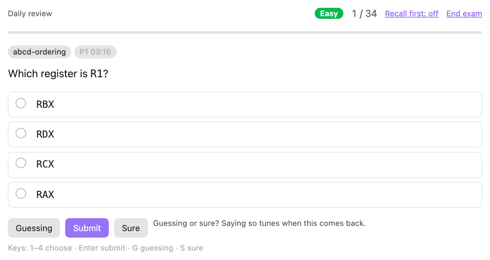
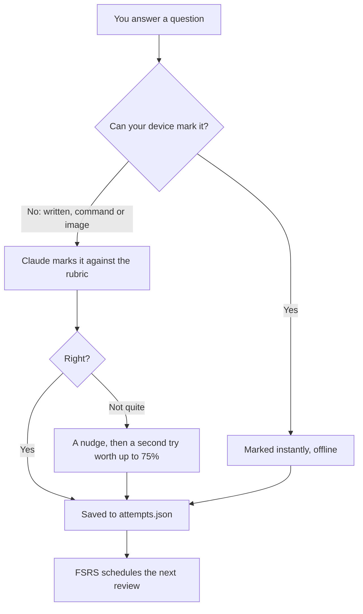
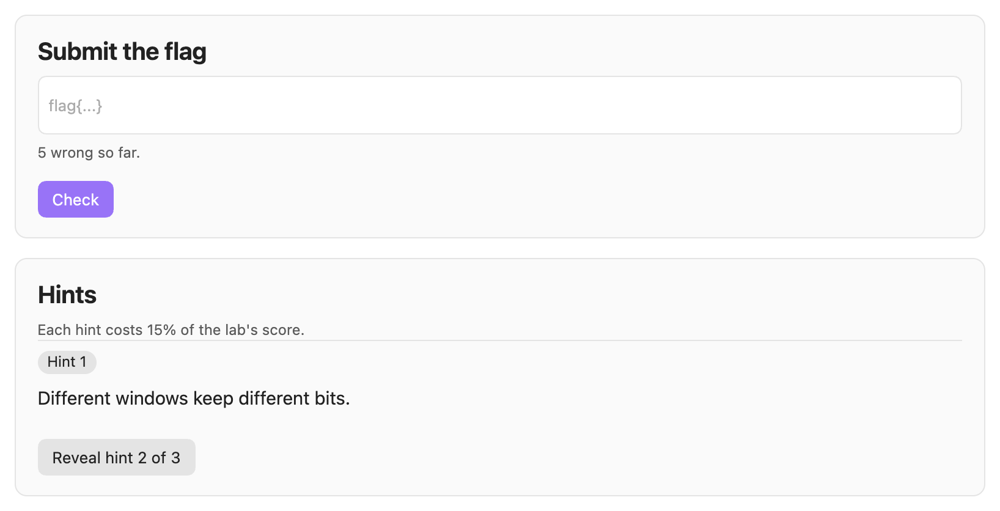
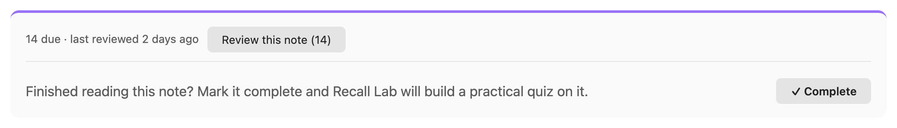

# User guide

This guide covers everything Recall Lab does. If you only want to get started, read the [README](../README.md).

- [Courses, quizzes and labs](#courses-quizzes-and-labs)
- [Exams](#exams)
- [How answers are marked](#how-answers-are-marked)
- [Daily review](#daily-review)
- [Practice beyond questions](#practice-beyond-questions)
- [Labs](#labs)
- [Memory map and skill radar](#memory-map-and-skill-radar)
- [Keyboard shortcuts](#keyboard-shortcuts)
- [Commands](#commands)
- [Settings](#settings)
- [Files](#files)
- [Troubleshooting](#troubleshooting)

## Courses, quizzes and labs

**Set up a course.** Pick a folder under **Folders** in the Recall Lab sidebar and press **Set up this course**. Claude reads a sample of its notes and names 5–7 skill areas. These become the spokes of the course's radar.

**Build a quiz for a note.** You can do this in three ways:

- press **Generate** next to the note in the course view;
- press **Complete** at the end of any note in a course folder;
- run **Quiz me on this note**.

To build a quiz again from the current note, press the rebuild icon next to the note. Its questions are replaced.

**Build every missing quiz.** In the course view, **Generate all N missing quizzes…** shows an estimate and asks before it starts. The command **Generate quizzes for notes in course folders** starts right away. To stop either one, press **Stop** in its notice or run **Stop quiz generation**.

Builds run one at a time. Anything you ask for during a build waits in a queue, and the same note is never built twice.

**Fill in your highlights.** Each sentence in a course note that has `==highlighted==` text becomes a fill-in-the-blank question. These are made on your device; Claude is not involved. They join the note's exams. They also join your daily review as soon as you write them, without waiting for you to complete the note. A question keeps its history until you edit its sentence, and renaming or moving the note doesn't lose it. Highlights are skipped when they are inside code or a table row, or when their sentence contains `{`, `}` or `|`.

**Remove leftovers.** Quizzes and labs are tied to their note by its path, and courses to their folder. After you delete or rename notes, run **Remove leftover quizzes, labs and courses**. It lists everything whose note or folder is gone and, once you confirm, moves it to the trash. Your answer history is kept.

## Exams

There are three tiers:

- **Easy**: recall.
- **Hard**: application.
- **Brutal**: synthesis and hands-on work.

An exam doesn't make you pick a tier. It ramps through all three: about 45% easy, then 35% hard, then 20% brutal. If a tier doesn't have enough questions, the shortfall goes to the next tier up.

**Tiers unlock as you go.** Each quiz opens its tiers on its own:

- **Hard** opens once you own 80% of the quiz's Easy questions.
- **Brutal** opens once you own 80% of its Hard questions.

To work out how much of a tier you own, Recall Lab averages each question's last three scores. A question you haven't answered counts as zero. So a tier opens when you have covered it, not when you have aced the few questions you tried.

You can change both thresholds under **Settings → Progression**. Setting one to 0 turns that gate off.

Until a tier opens, exams leave it out and fill the paper from the open tiers. The first page of the exam says what is locked and how far you are from opening it. When an exam opens a tier, the results page tells you.

**Include locked tiers** on that first page starts the same exam again with every tier in it. It appears only while **Allow drilling locked tiers** is on. In the course view, a padlock on a quiz's question count shows that it has locked tiers; hover over it to see why.

Within each tier, questions you haven't seen come first, then your weakest, then the ones you haven't seen for the longest. That way, a repeat exam isn't the same paper. An exam asks up to 15 questions; **Default session length** changes this.

| Question type | What you do | Marked by |
|---|---|---|
| Multiple choice | Pick one option. | Your device |
| Select all | Pick every option that applies. | Your device |
| Short answer | Write an answer. | Claude, unless the question's accept pattern matches |
| Command | Type a shell command. | Claude, unless the question's accept pattern matches |
| Image | Attach or paste a screenshot, then explain what it shows. | Claude, from your explanation only (it can't see the image) |
| Click the bug | Click the faulty line in numbered code. | Your device |
| Step-through trace | Fill in register and flag values after each instruction. | Your device, step by step |
| Order the steps | Drag the steps, or use the arrow buttons, to put them in order. | Your device |
| Match | Pick the right partner for each item. | Your device |
| Fill in the blank | Type the missing words. | Your device |

When you finish an exam, Claude reads the whole exam back. It then coaches you on the pattern behind your mistakes.

**How sure are you?** Every question has three submit buttons: *Guessing*, *Submit* and *Sure*.

- If you were guessing and got it right, the question comes back as if you had missed it.
- If you were sure, got it right and answered faster than usual, it is spaced further out.
- Plain *Submit* says neither.

Mistakes you were sure about get their own list on the results screen. History shows how often each level of confidence turned out right.

## How answers are marked

Your device marks choice, hands-on and fill-in-the-blank questions. It also passes a written or command answer that matches the question's accept pattern. Everything else goes to Claude.

An open answer is marked in place. The model answer shows while Claude marks it. Then you see your score, the feedback and any rubric points you missed.

Every marking request includes your **Strictness** setting: lenient, normal or brutal.

If Claude can't be reached, your answer is kept along with the reason, so an exam never stalls. It doesn't count against you: it is left out of your scores and your schedule.

An accept pattern that doesn't match never fails an answer. The answer simply goes to Claude, so a correct answer worded in an unusual way is never failed by a pattern.

**Second try.** When Claude marks a written answer as not right, it also asks you one nudging question. The nudge points at what you missed without giving it away. You can then try again before the model answer shows.

The second try is marked again, which is one more Claude request. It earns at most 75%, and the question comes back sooner because you needed the nudge. To turn second tries off, go to **Settings → Questions**.

## Daily review

Every answer you give, in any exam, feeds a spaced-repetition schedule run by [FSRS](https://github.com/open-spaced-repetition/ts-fsrs). This is the same scheduler Anki adopted in version 23.10.

You can start a review in two ways:

- **Today's review** on the overview;
- the **Start today's review** command.

A review asks what is due across every course, closest to forgotten first. Then it adds new questions, up to your daily allowance. New questions only come from notes you have marked complete or already taken an exam on, and only from tiers their quiz has opened. Questions made from your highlights are the exception: they can come in as soon as you write them, after the new questions from notes you have completed or examined. A question you have already answered stays in your reviews, even if its tier is locked. Each course also has its own review.

A miss brings a question back the next day, and each correct answer pushes it further out. Answers are saved as you go, so you can stop at any point.

Reviews stay offline, except for marking written answers. Feedback from Claude is one button away instead of automatic.

The schedule itself is never stored. It is rebuilt from `attempts.json` every time, so it always matches your real history.

**Variants.** Once you have answered a question right twice in a row, its look might start giving the answer away: where the right option sits, or how the question is worded. A course with questions like this offers **Write variants**, and so does the command **Write variants for mature questions**.

Claude writes two versions of each question. They test the same idea, worded differently. Recall Lab asks first, because this uses your plan. Reviews then ask a variant instead of the mature question, rotating through the variants, and your answer still counts toward the original question's schedule.

**Leech clinic.** Some questions are leeches: you have missed them four or more times and haven't since got them right twice in a row. That usually means a misunderstanding rather than forgetting, and more reviews won't fix it. The overview lists these questions.

Press **Diagnose (uses Claude)** on one, and Claude reads your wrong answers. It names the misconception and writes a short step-by-step lesson, plus a fresh question on the same idea. Your answer to that question counts toward the original's schedule.

**Streaks.** Your streak counts days that end with nothing overdue, however much you answered. Today can't break your streak until it is over. A day is recorded once it ends, so changing the target recall later never rewrites it. History shows a year of activity as a calendar, with overdue days outlined.

## Practice beyond questions

**Recall before recognition** hides the options of multiple-choice and select-all questions until you have recalled the answer, by typing it or just by thinking of it. Producing an answer builds memory better than spotting one. Whatever you typed is shown above the options and kept with your answer.

Turn it on in **Settings → Questions**, or switch it during an exam with *Recall first* in the exam bar. If you switch it while options are already showing, the change starts with the next question.

**Guided steps.** A brutal problem can carry 3 to 5 smaller steps that build up to it. Each step is a question marked on your device. If the problem is new to you, or you missed it last time, you work through the steps first, then answer the whole problem on your own.

Steps are written per course when you ask for them, with **Write guided steps** (this uses Claude). Your answers to the steps are not recorded.

**Write it all down.** Open it with the pencil next to a note, or with **Write down everything I remember about this note**. You get a clock (three minutes by default). Without looking at the note, write down everything you remember.

Claude then compares what you wrote with the note, section by section (one request). It shows:

- what you covered;
- what you left out, with links to those sections;
- how much of the note came back.

**Start the quiz** then asks about the sections you left out first. History keeps your recent results. If you leave the page before pressing **Done**, it waits for you: open the same note's page again to pick up your writing and the clock.

**Teach it back.** Open it with the speech bubble next to a note, or with **Teach this note back**. You explain the note to a curious beginner, played by Claude. Claude asks one question at a time wherever you were vague or skipped something, up to three questions by default. It stops early once you have covered the note.

Claude then scores how many of the note's key points you got across, anywhere in the conversation. It links the points you never reached. Each reply from the student is one Claude request, and the score is one more.

## Labs

**Writing labs.** Press **Labs** next to a note that has a quiz and no labs yet. Claude writes three CTF-style challenges: one easy, one hard and one brutal.

Each lab gives you one source file that you can solve by reading. Your goal is a flag in the form `flag{...}`. Only a SHA-256 hash of each flag is kept.

To compile or run a lab yourself, open **Optional: work on it locally** on the lab's page. Press **Write the file to disk**, and the file is written under `~/RecallLab/labs/`, outside your vault.

**Hints.** Hints read like a CTF's. Claude is asked for three nudges of at most eight words each, such as "Different windows keep different bits." A hint that is too long, quotes a long value or gives away the flag is dropped.

Each hint costs 15% of the lab's score. It appears in place, without redrawing the page.

**Binary challenges.** A source lab is solved by reading. A *binary challenge* is the other kind: you get a compiled, stripped x86-64 Linux program and reverse it the way you would a CTF challenge.

Build one from **Build a binary challenge…** in a course's Labs panel, or with the command **Build a binary challenge from this note**. Pick a difficulty:

| Tier | What it asks of you |
|---|---|
| Easy | One mechanism, traced carefully: partial-register writes, zero- versus sign-extension, endianness, a table lookup whose index you must follow. |
| Hard | A transformation to invert — a hand-rolled encoding, a key schedule, a compact instruction decoder — or obfuscated control flow to untangle. |
| Brutal | Several stages: a bytecode interpreter running an embedded program, a stage whose output keys the next, or code that decodes itself before running. |

The challenge is built from the note's own subject matter, so it tests what you have actually been studying rather than whatever an online challenge happens to cover.

Recall Lab compiles the challenge and runs it once on the input that is meant to solve it. A challenge is thrown away unless that input really prints the flag, and unless the flag is impossible to read out of the binary with `strings`. A password compared against a stored string is rejected for exactly that reason, so what you get always has something to reverse.

The binary lands in `~/RecallLab/labs/<challenge>/`, with a brief beside it. Copy it wherever you work — a Kali VM, say — and use your own tools on it. It reads from stdin and prints the flag only when the input is right. Submit that flag in Recall Lab as usual. The source is kept with the lab but stays hidden until you solve it or give up, and then it is shown as part of the solution.

**Exploitation challenges.** The third kind. You get a vulnerable x86-64 Linux program, **with symbols**, that has a stack bug you reach from stdin and a `win` function that prints the flag and is never called on its own. Reaching it is the exercise. Recall Lab never writes or runs an exploit — that part is yours.

Build one from **Exploitation challenge…** in a course's Labs panel, or with the command **Build an exploitation challenge from this note**. The tier decides the protections, so a tier always means the same thing:

| Tier | What you face |
|---|---|
| Easy | NX, no stack canary, no PIE — fixed addresses |
| Hard | NX, no canary, PIE — addresses move, so you need a leak |
| Brutal | NX, stack canary, PIE and full RELRO |

Before handing one over, Recall Lab checks it is worth your time. It compiles the program, confirms the flag cannot be read out of it with `strings`, runs it on ordinary input to be sure it prints nothing and exits cleanly, checks there is a `win` to aim at, and builds a second copy under the address sanitizer to confirm the bug is really there and really is a stack overflow. It also checks the protections came out as the tier intends. A challenge that fails any of those is thrown away rather than wasting your evening.

The binary lands in `~/RecallLab/labs/<challenge>/` like any other, with a brief that says what it was built with.

**Scoring.** A solved lab starts at 100%:

- each hint costs 15%;
- the first wrong flag is free, and each new wrong flag after that costs 5%;
- trying the same wrong flag again costs nothing;
- a solved lab never scores below 25%.

Older labs have step-by-step hints. **Shorten lab hints to CTF-style nudges** rewrites the hints of every lab you haven't solved or given up on. It asks first, and it handles up to four labs per Claude request. A lab's own page can also shorten just its own hints.

## Memory map and skill radar

**Dots on headings.** In reading view, each heading that questions point to gets a dot. It shows the score you could expect on those questions today:

| Dot | Expected score |
|---|---|
| Green | 80% or more |
| Amber | 50–79% |
| Red | Below 50% |
| Grey | None of its questions answered yet |

Hover over a dot for details.

**The note footer** shows how many of the note's questions are due and when you last reviewed it. **Review this note** reviews only what is due there; new questions come in the daily review. **The status bar** shows today's due count; click it to start reviewing. To turn off the dots, the footer and the status bar together, use **Settings → Daily review → Memory map on notes**.

**What you have done by hand.** Beside each skill area's score, the radar's legend says what you have actually taken apart: how many of its labs you have solved, at what score, and the hardest tier among them. An area with labs you opened and never finished reads differently from one you have never touched.

This is kept separate from the spoke's score on purpose. A spoke answers *how likely am I to get its questions right now*, and fades as you forget. A solved lab is not a question that comes due again, so folding it in would muddle what the spoke means. The course page also points out the gap worth knowing about: an area you answer well but have never proved by hand.

**The skill radar.** Each spoke is the score you could expect on that skill area today. It multiplies two numbers:

- how well you have answered the area's questions, using each question's mean over its last three scores, so one lucky guess doesn't erase a history of misses;
- how likely you are to still remember those questions.

Questions you have never answered count as zero. So a spoke tells you how much of the area you own, not how you did on the few questions you tried. Spokes fade between reviews, and a dashed outline shows where the radar stood a week ago.

## Keyboard shortcuts

These work on the exam screen.

| Key | Action |
|---|---|
| `1`–`9` | Pick an option |
| `Enter` | Submit |
| `G` / `S` | Submit as *Guessing* / *Sure* |
| `D` | Give up on a written answer |
| `Enter` or `Space` | Next question, once answered |
| `Cmd`/`Ctrl` + `Enter` | Submit from a text box |
| `Esc` | Leave the text box |

## Commands

Run these from the command palette. Each one starts with **Recall Lab:**.

| Command | What it does |
|---|---|
| Open view | Opens the Recall Lab view. The graduation-cap icon in the ribbon does the same. |
| Start today's review | Starts the daily review across every course. |
| Quiz me on this note | Builds the open note's quiz if it has none, then starts an exam. |
| Write down everything I remember about this note | Opens *Write it all down* for the open note. |
| Teach this note back | Opens *Teach it back* for the open note. |
| Mark this note complete and build its quiz | Does the same as the **Complete** button in the note's footer. |
| Generate quizzes for notes in course folders | Builds every missing quiz, one note at a time. |
| Stop quiz generation | Stops a running bulk build after the current quiz. |
| Write variants for mature questions | Writes reworded versions of questions you have mastered (uses Claude). |
| Write guided steps for brutal problems | Writes step-by-step build-ups for brutal problems (uses Claude). |
| Shorten lab hints to CTF-style nudges | Rewrites the long hints of older labs (uses Claude). |
| Build a reversing challenge from this note | Writes a compiled challenge to reverse (uses Claude, and Docker to build it). |
| Build an exploitation challenge from this note | Writes a vulnerable program with a `win` path to reach (uses Claude, and Docker to build it). |
| Remove leftover quizzes, labs and courses | Moves quizzes, labs and courses whose note or folder is gone to the trash, after you confirm. |
| Run diagnostics | Reports where the CLI is, whether Claude replies, and what your vault holds. |

## Settings

To find these, open **Settings → Recall Lab**.

| Section | Setting | Default | What it does |
|---|---|---|---|
| Claude | Model | Sonnet | Sonnet is balanced. Opus gives sharper feedback for about three times the usage. Haiku is cheapest. |
| Claude | Path to the Claude binary | *(empty)* | Leave this empty to find the CLI automatically. |
| Claude | Check the connection | | Press **Test** to confirm Recall Lab can reach Claude. |
| Binary challenges | Docker command | *(empty)* | Leave empty to find Docker automatically. |
| Binary challenges | Docker context | *(empty)* | Which Docker to use, if you keep more than one. |
| Binary challenges | Check the builder | | Press **Test** to confirm Docker answers and the builder image is ready. |
| Grading | Strictness | Brutal | How strictly Claude marks open answers: lenient, normal or brutal. |
| Questions | Recall before recognition | Off | Hides the options of choice questions until you have tried to recall the answer. |
| Questions | Fill in your highlights | On | Turns `==highlights==` into fill-in-the-blank questions. |
| Questions | Second try on written answers | On | Gives one nudge and a second try, worth up to 75%. |
| Questions | Guided steps | On | Walks you up to brutal problems that have steps. |
| Questions | Write it all down: minutes | 3 | The clock, from 1 to 10 minutes. |
| Questions | Teach it back: student questions | 3 | The most questions the student asks, from 1 to 5. |
| Questions | Leech clinic after | 4 | How many misses make a question a leech, from 2 to 10. |
| Daily review | Target recall | 90% | Higher means more frequent reviews. Ranges from 70% to 97%. |
| Daily review | New questions per day | 20 | Ranges from 0 to 100. |
| Daily review | Memory map on notes | On | Turns the heading dots, note footers and status bar on or off. |
| Progression | Mastery needed to unlock Hard | 80% | How much of a quiz's Easy tier you must own before its Hard questions are asked. 0 opens Hard straight away. |
| Progression | Mastery needed to unlock Brutal | 80% | How much of a quiz's Hard tier you must own before its Brutal questions are asked. |
| Progression | Allow drilling locked tiers | On | An exam that leaves locked tiers out offers to include them. Off, the gate is binding. |
| Progression | Default session length | 15 | Questions per exam, from 5 to 50. |
| Folders | Banks, Courses, Progress | `_quiz/banks`, `_quiz/courses`, `_quiz/progress` | Where Recall Lab keeps its files. |

## Files

Everything lives in your vault, apart from labs you choose to write to disk.

| Path | What it holds |
|---|---|
| `_quiz/courses/*.json` | Courses: the folder each one covers and its skill areas. |
| `_quiz/banks/*.json` | Question banks, one per note. The format is in [bank-format.md](bank-format.md). |
| `_quiz/labs/*.json` | Labs, with each flag stored only as a hash. |
| `_quiz/progress/attempts.json` | Your full history: every answer, score and piece of feedback, every exam, notes marked complete, lab progress, finished days for the streak, *Write it all down* and *Teach it back* results, and leech diagnoses. If it can't be read, it is never overwritten. |
| `_quiz/progress/recall-lab.log` | A plain-text log of the last 400 events, for when something goes wrong. |
| `~/RecallLab/labs/` | Lab files you chose to write to disk, and the binary of each binary challenge, outside the vault. |

## Troubleshooting

- **Recall Lab can't find the Claude Code CLI.** Set **Path to the Claude binary** to its full path, for example `/opt/homebrew/bin/claude`. Then press **Test** under **Check the connection**.
- **Something failed.** Use the **Run diagnostics** command. It shows where the CLI is and whether Claude replies (one small request). It also counts your courses, quizzes and exams. The details, along with every error, go to `_quiz/progress/recall-lab.log`.
- **A quiz build failed.** The reason is in the log. Press **Generate** to try again.
